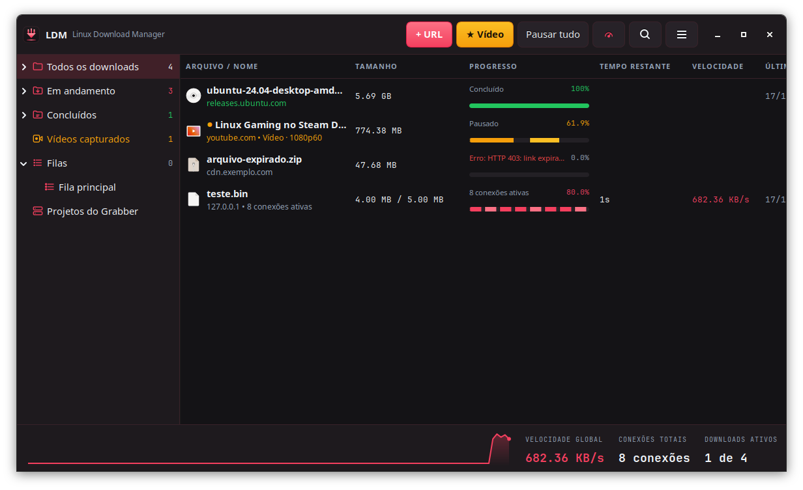
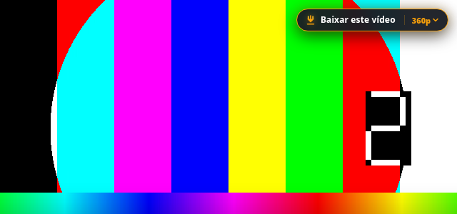
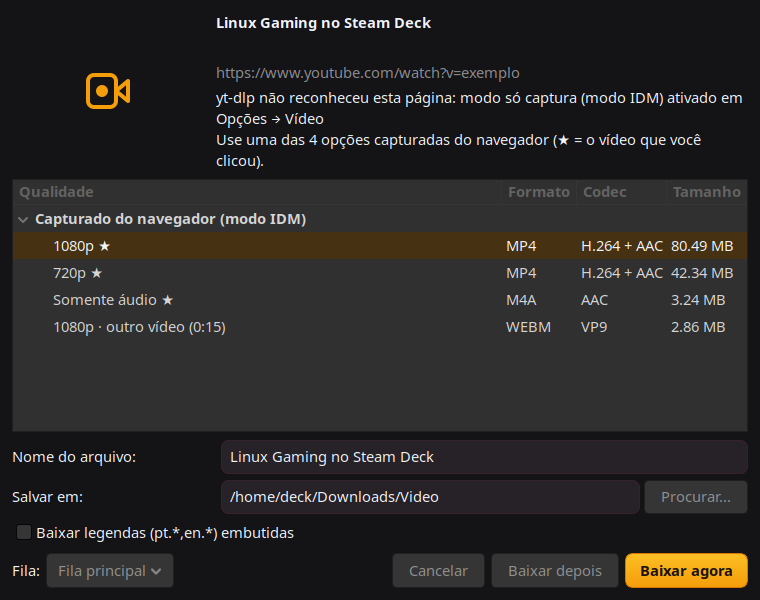
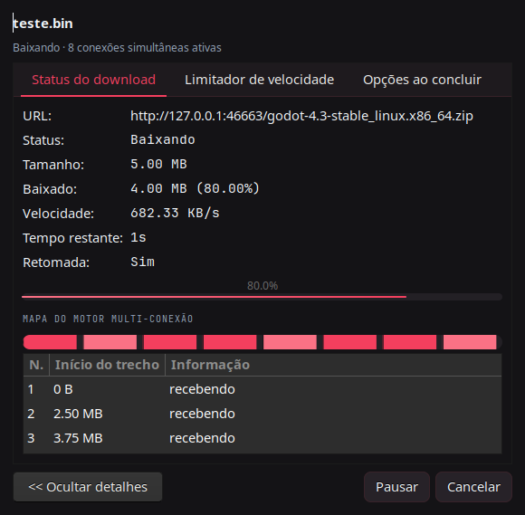
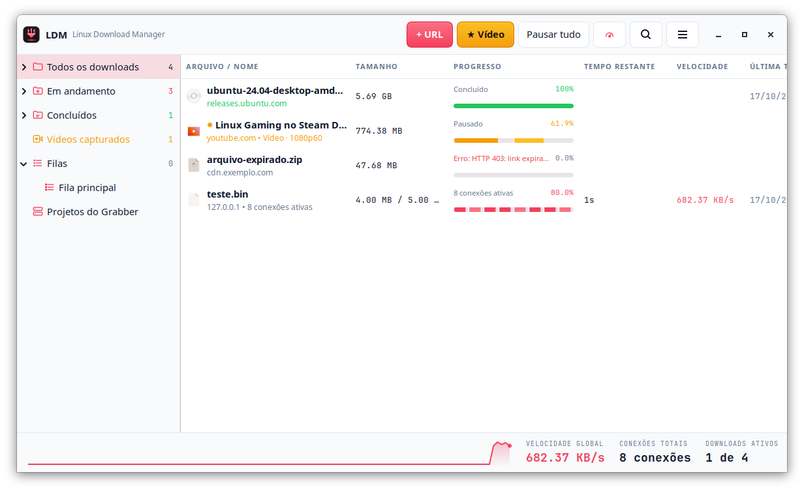

# Linux Download Manager (LDM)

[English](README.md) · **Português (Brasil)**

Gerenciador de downloads para Linux inspirado no Internet Download Manager. Acelera downloads com várias conexões e baixa vídeos de qualquer site por meio de uma extensão do navegador. Também tem filas, agendador, limitador de velocidade e Site Grabber.



## Download

**[⬇ Linux_Download_Manager-1.3.0-x86_64.AppImage](https://github.com/jcrodriguesjr0/linux-download-manager/releases/latest)** (~144 MB, arquivo único, sem instalar nada)

Traz Python 3.12, GTK 3, yt-dlp, Deno e ffmpeg. Roda em qualquer Linux x86_64 com glibc ≥ 2.39: SteamOS, Ubuntu 24.04+, Fedora 40+, Arch.

```bash
chmod +x Linux_Download_Manager-1.3.0-x86_64.AppImage
./Linux_Download_Manager-1.3.0-x86_64.AppImage            # abre o programa
./Linux_Download_Manager-1.3.0-x86_64.AppImage install    # cria o atalho no menu de aplicativos
./Linux_Download_Manager-1.3.0-x86_64.AppImage selftest   # diagnóstico dos componentes embutidos
```

Depois, instale a extensão do navegador (veja abaixo).

## Funcionalidades

**Motor de download**
- Várias conexões com segmentação dinâmica: a conexão que termina assume metade do maior trecho restante.
- Retomada após pausa, travamento ou reinício do computador.
- HTTP, HTTPS e FTP; streams HLS convertidos para `.mp4`.
- Proxy, logins por site, cookies, referer e User-Agent personalizado.
- Limitador de velocidade global e por arquivo.

**Grabber de vídeo**
- Botão **"Baixar este vídeo"** sobre qualquer `<video>` de qualquer site, inclusive em iframes e em tela cheia.
- Escolha de qualidade, somente áudio/MP3, legendas embutidas e playlists inteiras.
- YouTube e cerca de 1.800 sites via yt-dlp. Os streams diretos usam o motor multi-conexão do LDM e são mesclados com ffmpeg.
- **Captura passiva**, como no IDM, para sites que o yt-dlp não conhece:
  - registra as requisições de mídia que o player faz;
  - remonta arquivos baixados em fatias (`range=`);
  - lê as respostas de `fetch`/XHR para achar manifests HLS/DASH escondidos em APIs JSON;
  - marca com ★ o vídeo clicado e separa anúncios.
- Sites que exigem login usam os cookies do navegador.

**Integração com o navegador**
- Captura downloads no Chrome, Edge, Chromium e Firefox, filtrando por tipo de arquivo, tamanho mínimo e sites de exceção.
- Menu de contexto: "Baixar com o LDM", "Baixar todos os links" e "Baixar links selecionados".
- **Alt+clique** deixa o navegador baixar; **Ctrl+Alt+clique** força o LDM. As duas teclas são configuráveis.

**Organização**
- Categorias (Compactados, Documentos, Músicas, Programas, Vídeos), cada uma com suas extensões e pastas.
- Pesquisa, colunas configuráveis e propriedades do arquivo.
- Importação e exportação de listas `.ef2` do IDM e de texto.
- Prévia de ZIP antes de baixar.

**Filas e agendador**
- Várias filas com downloads simultâneos.
- Início e parada em horários ou dias da semana, e sincronização periódica.
- Ao concluir: sair, desligar ou abrir o arquivo.

**Site Grabber**
- Explora um site por níveis de links, tipos de arquivo, caminhos e tamanho, e salva projetos.

**Integração com o desktop**
- Ícone na bandeja e início automático ao ligar o computador (minimizado, opcional).
- Identidade "Fluxo Segmentado": escuro primeiro, com modo claro, ícones próprios e as fontes Inter e JetBrains Mono embutidas. Os arquivos ficam em `identidade_visual/`.
- Notificações e sons; antivírus após o download.

| Botão sobre qualquer player | Escolha da qualidade | Progresso |
|---|---|---|
|  |  |  |

Modo claro: 

## Extensão do navegador

A extensão fica em `browser_extension/`. Na AppImage, **Ajuda → Extensão do navegador** copia a extensão para `~/Documents/LinuxDownloadManager-extensao` e abre o navegador.

- **Chrome / Edge / Chromium:**
  1. Abra `chrome://extensions` e ligue o **Modo do desenvolvedor**.
  2. Clique em **Carregar sem compactação** e escolha a pasta da extensão.
- **Firefox:**
  1. Abra `about:debugging` → **Este Firefox** → **Carregar extensão temporária**.
  2. Escolha o `manifest.json`.

A extensão conversa com uma API local em `127.0.0.1:9614`, então funciona também com navegadores Flatpak, que não conseguem executar hosts de native messaging. A API só aceita requisições de origem `chrome-extension://` ou `moz-extension://`, ou de clientes locais que enviam o cabeçalho `X-LDM-Client` sem `Origin`. Páginas web ficam bloqueadas.

## Rodar pelo código-fonte

Requisitos:
- Python 3.10+ com GTK 3 (PyGObject); só a biblioteca padrão é usada.
- Opcionais: `ffmpeg` (mesclagem e HLS), `yt-dlp` (sites de vídeo), `canberra-gtk-play` (sons) e `notify-send` (notificações).

```bash
python3 ldm.py                 # interface
python3 ldm.py --tray          # inicia minimizado na bandeja
python3 ldm.py install         # cria o atalho no menu de aplicativos
python3 ldm.py add URL         # envia uma URL para a instância aberta
python3 ldm.py video URL       # baixa o vídeo da página (abre a escolha de qualidade)
python3 ldm.py get URL -o ~/Downloads -c 8 -l 2048   # só terminal: 8 conexões, limite de 2 MB/s
```

**yt-dlp:** o LDM procura nesta ordem:
1. o caminho definido em Opções → Vídeo;
2. a cópia embutida na AppImage;
3. `~/.local/share/ldm/ytdlp`;
4. o `PATH`;
5. uma distrobox indicada nas opções (útil em sistemas imutáveis como o SteamOS).

Use **Opções → Vídeo → Instalar/atualizar yt-dlp** sempre que um site parar de funcionar.

As configurações ficam em `~/.config/ldm/settings.json`. A lista de downloads, as filas, os temporários e os projetos do grabber ficam em `~/.local/share/ldm/`.

## Estrutura

```
ldm.py                 lançador e CLI
ldm/engine.py          motor multi-conexão (segmentação dinâmica, retomada, arquivo .part esparso)
ldm/media.py           grabber de vídeo: yt-dlp, qualidades, motor nativo + ffmpeg, captura passiva
ldm/hls.py             HLS -> mp4 sem yt-dlp (alternativa)
ldm/net.py             HTTP/FTP, proxy, logins por site, limitador de velocidade, prévia de ZIP
ldm/manager.py         lista persistente, filas, agendador, ações ao concluir
ldm/grabber.py         Site Grabber
ldm/server.py          API local para a extensão e a CLI
ldm/gui/               janelas e diálogos GTK 3
browser_extension/     extensão MV3 (Chrome/Edge/Firefox): botão sobre o vídeo, sniffer de rede, hook na página
packaging/appimage/    script de geração da AppImage
identidade_visual/     logo, ícones, cores e capturas de tela
tests/                 testes unitários e teste ponta a ponta no navegador
```

## Testes

```bash
python3 -m unittest discover -s tests -v
```

O `tests/e2e_browser.py` carrega a extensão num Chromium real com Playwright e roda 12 cenários: botão na página, sniffer, captura de download, player MSE, APIs JSON, MPD embutido, remontagem de `range=` e teclas de captura. Para rodar, aponte `PLAYWRIGHT_BROWSERS_PATH` para os navegadores do Playwright.

## Gerar a AppImage

No Ubuntu 24.04 (pode ser numa distrobox), com `python3-gi python3-gi-cairo gir1.2-gtk-3.0 librsvg2-common libgdk-pixbuf2.0-bin python3-pip`:

```bash
python3 packaging/appimage/build_appimage.py      # resultado em dist/
```

## Limitações

- Conteúdo com DRM (Netflix, Prime Video, Disney+) não pode ser baixado.
- Quando o YouTube entrega um vídeo só pelo protocolo SABR/UMP, não há link reaproveitável para capturar; esses vídeos são baixados pelo yt-dlp.

## Componentes de terceiros na AppImage

| Componente | Licença |
|---|---|
| [Python](https://www.python.org/) | PSF |
| [GTK 3](https://gtk.org/), GLib, PyGObject | LGPL-2.1+ |
| [yt-dlp](https://github.com/yt-dlp/yt-dlp) | Unlicense |
| [Deno](https://deno.com/) | MIT |
| Fontes [Inter](https://rsms.me/inter/) e [JetBrains Mono](https://www.jetbrains.com/lp/mono/) (`data/fonts`) | SIL OFL 1.1 |
| [FFmpeg](https://ffmpeg.org/), build estático de [John Van Sickle](https://johnvansickle.com/ffmpeg/) | GPL-3.0; código-fonte nos links |

## Licença

[MIT](LICENSE). O LDM é um projeto independente, sem vínculo com a Tonec Inc. ou com o Internet Download Manager.
